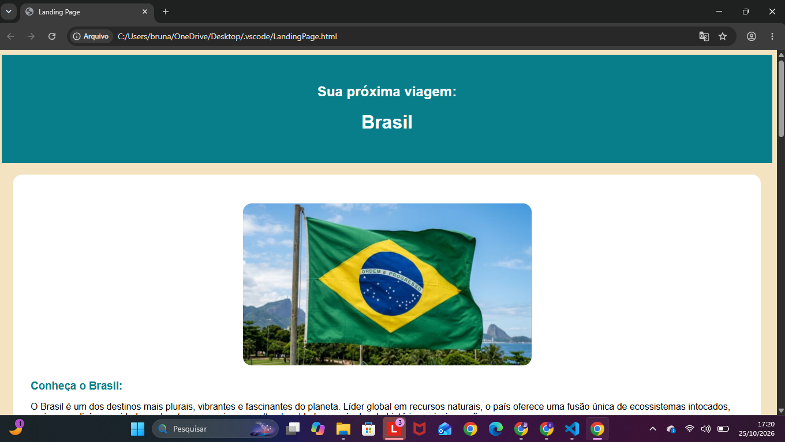
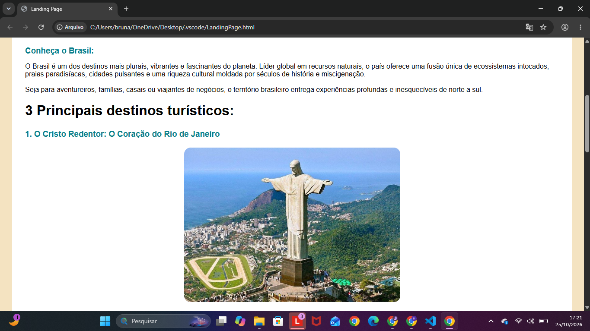
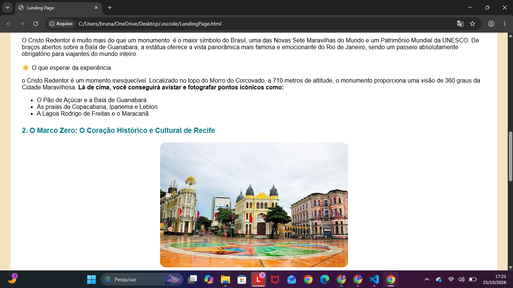
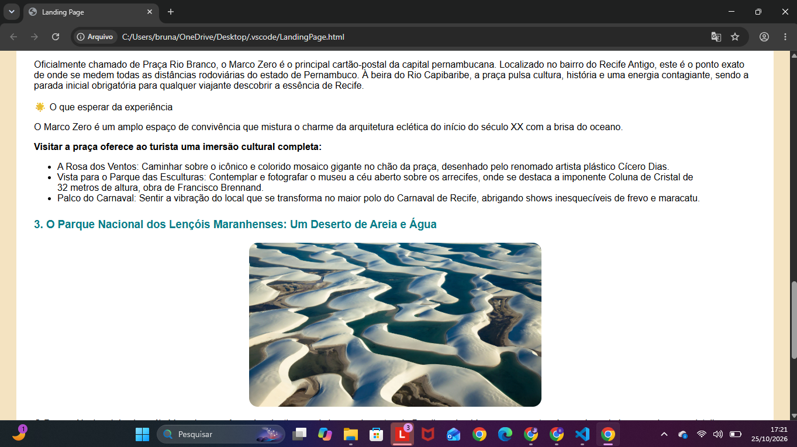
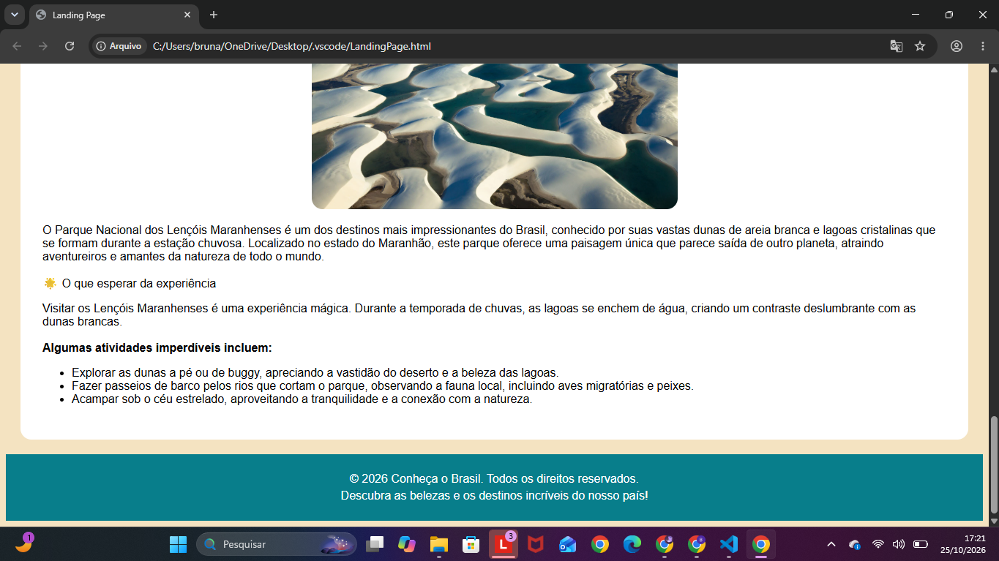

# 🇧🇷 Landing Page — Conheça o Brasil

Projeto desenvolvido durante um curso online da Rocketseat, com o objetivo de praticar os fundamentos de HTML e CSS por meio da criação de uma landing page sobre destinos turísticos brasileiros.

## 💻 Tecnologias utilizadas

- HTML5
- CSS3

## ✨ Sobre o projeto

A página apresenta alguns dos principais destinos turísticos do Brasil, incluindo o Cristo Redentor, o Marco Zero de Recife e o Parque Nacional dos Lençóis Maranhenses.

O projeto foi desenvolvido para praticar a estruturação de páginas HTML e a estilização com CSS, incluindo cores, espaçamentos, imagens centralizadas e organização do conteúdo.

## 📸 Demonstração

 

